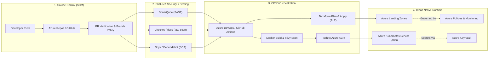

<div align="center">

  <!-- Header Banner -->
  

  <!-- Dynamic Typing Subtitle -->
  <a href="https://git.io/typing-svg">
    
  </a>

  <br/>

  <!-- High-Impact Experience Pills -->
  <p align="center">
    
    
    
    
  </p>

  <!-- Connect Links -->
  <p align="center">
    <a href="mailto:yadvesh.cest@gmail.com">
      
    </a>
    <a href="https://linkedin.com/in/yadvesh-yadav" target="_blank">
      
    </a>
    <a href="https://github.com/Yadvesh98" target="_blank">
      
    </a>
  </p>

</div>

---

### 🛡️ Professional Profile & Executive Summary

```yaml
professional_summary:
  name: Yadvesh Yadav
  current_focus: Senior DevSecOps & Cloud Platform Engineering
  total_it_experience: 11+ Years
  devsecops_experience: 5+ Years
  core_specializations:
    - Enterprise Azure Landing Zones (ALZ) & Cloud Governance
    - Infrastructure as Code (Terraform IaC) & Modular Architecture
    - Secure CI/CD Engineering (Azure DevOps & GitHub Actions)
    - Source Code Management (GitHub & Azure Repos with Branch Policies)
    - Containerization & Orchestration (Docker & Kubernetes / AKS)
    - Shift-Left DevSecOps (SAST, DAST, Container Scanning, Policy as Code)
```

- ☁️ **Azure Cloud & Landing Zones:** Designing and deploying scalable **Enterprise Azure Landing Zones (ALZ)** based on Cloud Adoption Framework (CAF), including Hub-and-Spoke networks, Subscription vending, Management Groups, RBAC, and Azure Policies.
- 📜 **Infrastructure as Code (IaC):** Deep hands-on expertise building production-ready, reusable **Terraform** modules to provision, govern, and maintain immutable infrastructure.
- 🔄 **CI/CD & Pipeline Security:** Engineering end-to-end multi-environment automated release pipelines using **Azure DevOps Pipelines** (YAML) and **GitHub Actions**, integrating automated quality gates and security checks.
- 🗄️ **SCM & Enterprise Governance:** Managing enterprise repositories across **GitHub** and **Azure Repos**, enforcing zero-trust branch policies, pull request approvals, automated semantic versioning, and credential scanning.
- 🐳 **Containers & Kubernetes:** Packaging microservices with **Docker**, configuring **Kubernetes (AKS)** clusters, managing ingress, Helm charts, secret integration (Azure Key Vault), and pod security standards.
- 🔒 **Shift-Left DevSecOps:** Embedding automated vulnerability management into pipelines — Static Code Analysis (SAST), Container Vulnerability Scanning, Dependency Checks, and Policy-as-Code.

---

### 🧰 DevSecOps Technology Radar & Toolbelt

<div align="center">

#### ☁️ Cloud & Infrastructure as Code (IaC)
<p align="center">
  
  
  
  
  
  
</p>

#### 🔄 CI/CD & Source Code Management (SCM)
<p align="center">
  
  
  
  
  
  
</p>

#### 🐳 Containerization & Cloud-Native Orchestration
<p align="center">
  
  
  
  
  
</p>

#### 🔒 DevSecOps, Compliance & Security Tooling
<p align="center">
  
  
  
  
  
  
</p>

#### 💻 Scripting, Automation & Systems
<p align="center">
  <a href="https://skillicons.dev">
    
  </a>
</p>

</div>

---

### 🏗️ Architecture & DevSecOps Implementation Lifecycle



---

### 📊 GitHub Analytics & Activity

<div align="center">
  <table border="0">
    <tr>
      <td align="center">
        
      </td>
      <td align="center">
        
      </td>
    </tr>
  </table>

  <br/>

  <!-- GitHub Streak Stats -->
  

</div>

---

### 🏆 GitHub Achievements & Trophies

<div align="center">
  <a href="https://github.com/ryo-ma/github-profile-trophy">
    
  </a>
</div>

---

### 📈 Activity & Contribution Graph

<div align="center">
  
</div>

---

### 🤝 Let's Connect & Build Resilient Systems!

<p align="center">
  Open to conversations on Enterprise Cloud Migration, DevSecOps Transformation, IaC Governance, and Kubernetes Security.
</p>

<p align="center">
  <a href="mailto:yadvesh.cest@gmail.com"></a>
  <a href="https://linkedin.com/in/yadvesh-yadav"></a>
  <a href="https://github.com/Yadvesh98"></a>
</p>

<!-- Dynamic DevSecOps Quote -->
<div align="center">
  
</div>

<br/>

<!-- Footer Wave -->
<div align="center">
  
</div>